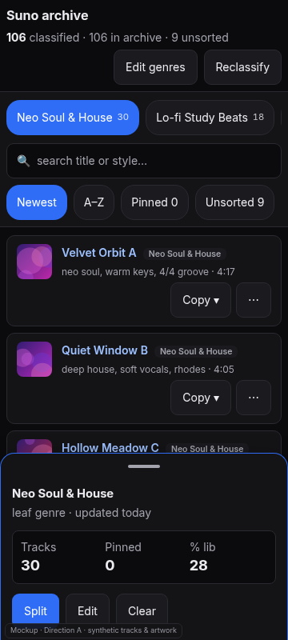
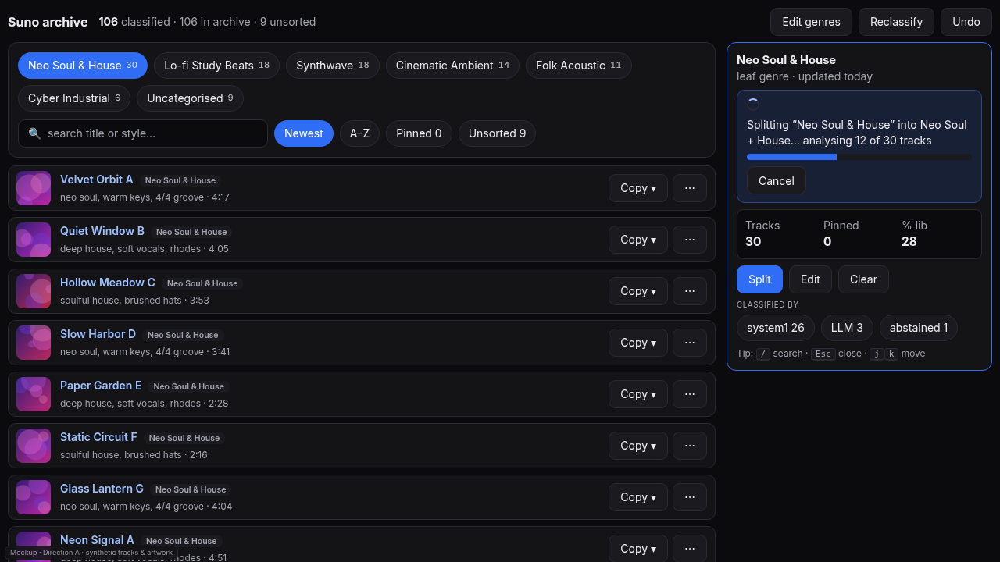
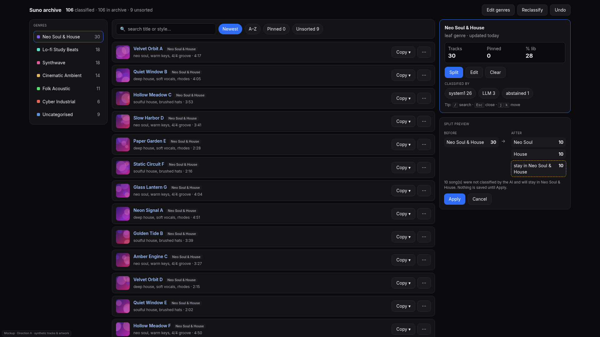
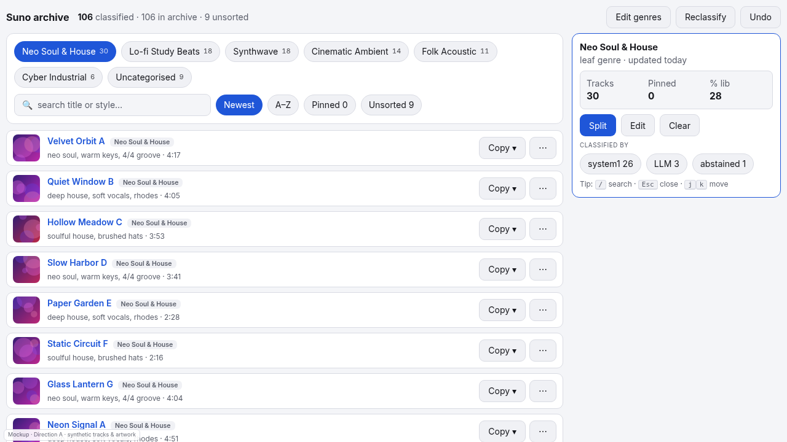
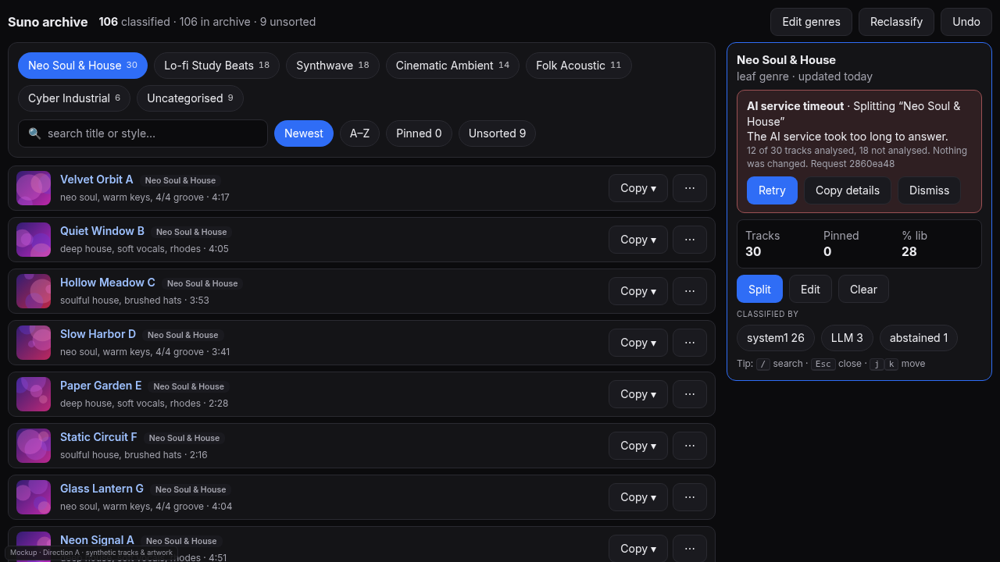

# Direction A: today's layout, tuned (genre chips → detail pane)

Mockup: [`mockups/a-tuned-current.html`](mockups/a-tuned-current.html) · synthetic data only.

## Audience
Everyone who uses the card or web UI today. Best when the library is browsed more than it is reorganised.

## What it is
The same model as now (chips, track list, detail pane), with three breakpoints that each get a purpose-built layout:

- **Mobile (<= 760px):** sticky search + chips + filters at the top; track rows with a 44px cover; the detail pane is a
  bottom sheet with a peek state (title, stats, Split / Edit / Clear) and an expanded state; running state and errors
  render inside the sheet, where the action was started.
- **Laptop (1280x720, the tightest):** chips and filters in one sticky card, list left, 340px pane right, header
  compressed so the first screen shows the pane's actions without scrolling.
- **Desktop (>= 1500px):** three zones: a genre rail (replaces the chips), the track list, and a right column with the
  detail pane over a dedicated **Split preview** (before → after counts, the "stay in parent" bucket, Apply / Cancel).

## Pros
- Lowest risk and effort; users already know it; keeps keyboard shortcuts.
- Covers get a real place (44px thumbnails) without changing the model.
- The desktop preview column makes a split reviewable *before* Apply, side by side with the list.

## Cons
- Still a list-and-pane browser: it does not help find lopsided genres or merge them.
- The 3-zone desktop layout needs ~1500px, so most laptops see the 2-zone one.

## Effort (estimate, not measured)
Small: about 2–4 days. CSS plus a preview column; no data-model change. The viewport/a11y fixes in this PR already
cover the mobile half.

## Risks
- Breakpoints are by *container* width (the card can sit in a narrow HA column), so each needs a browser test, as the
  viewport tests in this PR do.
- Rail + chips must never both show (the mock hides the chips from 1500px).

## How progress, errors and undo are shown
- **Progress:** one status line + progress bar + Cancel at the top of the pane (`analysing 12 of 30 tracks`); every
  other action is disabled meanwhile; also announced through a persistent `aria-live` region.
- **Errors:** a banner in the pane naming the cause class (timeout / unreachable / invalid or empty reply / file or
  permission / unexpected), what completed, request id and time, with Retry / Copy details / Dismiss.
- **Partial replies:** the preview says "N song(s) were not classified and will stay in <genre>"; nothing is applied
  until Apply.
- **Undo:** the existing header Undo, plus an Undo link in the "Split applied" confirmation.

## What the HA card and the web UI must share
The same `suno-genre-card.js` and `suno-genre-core.js`, the same tokens (this PR's `--sg-*` variables), the same
`aria-live` regions and test harness. The web UI differs only by `standalone` (read-only) mode, which hides Split / Edit
and says why.

## Mobile behaviour
Bottom sheet with peek/expanded states, drag handle (44px hit area) and a button alternative to dragging; Esc or the
close button returns focus to the chip that opened it; 44px controls; the sticky filter never covers the working banner.

## Accessibility
Chips are toggle buttons with `aria-pressed`; the pane is a labelled landmark that takes focus when opened by keyboard;
contrast meets AA on its own dark surface; light theme is a **real palette** here (see the light shot), which the
current card does not have (today it paints a dark surface under any host theme).
