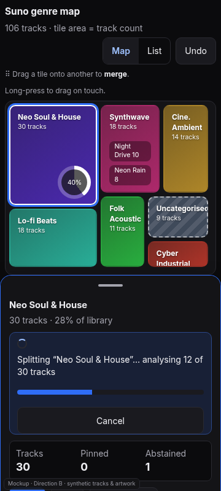
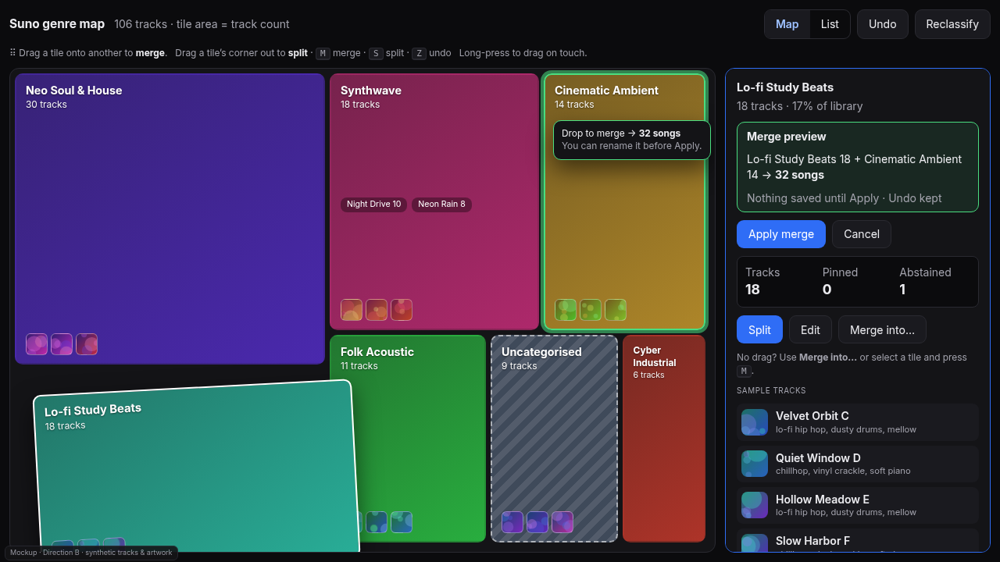
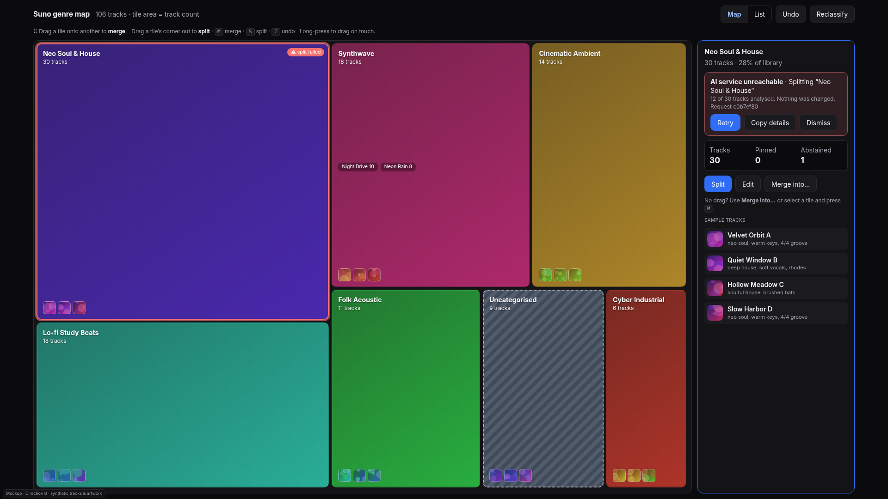
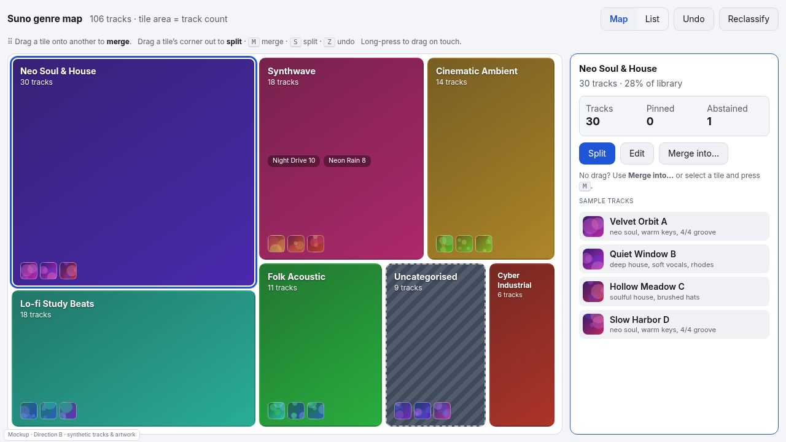

# Direction B: genre map (treemap, drag to merge, split from the tile)

Mockup: [`mockups/b-genre-map.html`](mockups/b-genre-map.html) · synthetic data only.

## Audience
People who reorganise a big library: they want to see where the weight is, spot a 30-track blob next to a 6-track
sliver, and fix it by moving things rather than by reading counts.

## What it is
A squarified **treemap**: one tile per genre, area = track count, nested sub-tiles for subtiers, a hatched dashed tile
for Uncategorised. Selecting a tile opens the same detail drawer as today (right on desktop, bottom sheet on mobile).
**Drag a tile onto another** to merge (a preview shows the combined count; nothing is saved until Apply); split is a
drawer action whose progress ring appears **on the tile itself**.

## Pros
- Instantly shows imbalance and what is unsorted; merging is a single gesture.
- Progress and failure are visible where the user is looking (the tile ring / red tile with "split failed").

## Cons
- A different mental model: track browsing moves to the drawer or a List toggle.
- Small genres become tiny tiles on a phone.
- Merge does not exist in the card today: it needs a new, atomic operation (rename + move assignments).

## Effort (estimate, not measured)
Large: about 2–3 weeks. Treemap layout and tile rendering are modest; the merge operation, drag handling with pointer
events, undo for merge, and a keyboard/touch alternative are the bulk.

## Risks
- **Drag is not accessible by itself** (WCAG 2.5.7): every drag has a button path (`Merge into…`, `M`, `S`, `Z`) and
  tiles are focusable buttons with names like "Cinematic Ambient, 14 tracks". These paths must be built and tested, not
  just drawn.
- Touch precision: long-press-to-drag on a 360px-wide map with tiny tiles is easy to get wrong.
- Colour is used for identity, never as the only signal (names and counts are always present).

## How progress, errors and undo are shown
- **Progress:** a ring on the tile + the drawer's working line, progress bar and Cancel.
- **Errors:** the tile gets a red outline and a "split failed" badge; the drawer shows the usual banner (cause class,
  what completed, Retry / Copy details / Dismiss). Nothing changes on failure.
- **Merge preview:** drop target highlights, a tooltip says `→ 32 songs`, the drawer shows Apply merge / Cancel.
- **Undo:** header Undo and `Z`; each applied merge or split is one undo step.

## What the HA card and the web UI must share
The map is another view inside `suno-genre-card.js` (a `Map | List` toggle), not a separate app, so the drawer, the
operation states, tokens and live regions are reused. The web UI is the same view in read-only mode: tiles are
selectable, drag and Split/Merge are disabled with the usual reason text.

## Mobile behaviour
Map on top, drawer as a bottom sheet (peek by default); long-press drags; `Merge into…` is the reliable path;
covers are hidden in tiles below a size threshold; the List toggle is the fallback for very small genres.

## Accessibility
Tiles are real buttons in a labelled application region with arrow-key navigation; every drag has a button alternative;
progress/failure are announced through the same persistent live regions; reduced-motion removes the drag tilt.
