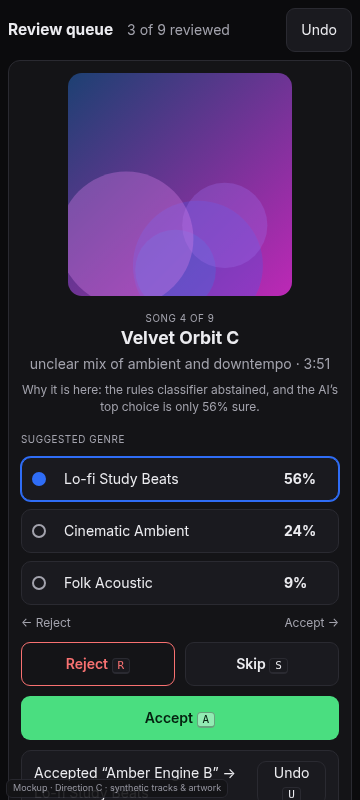
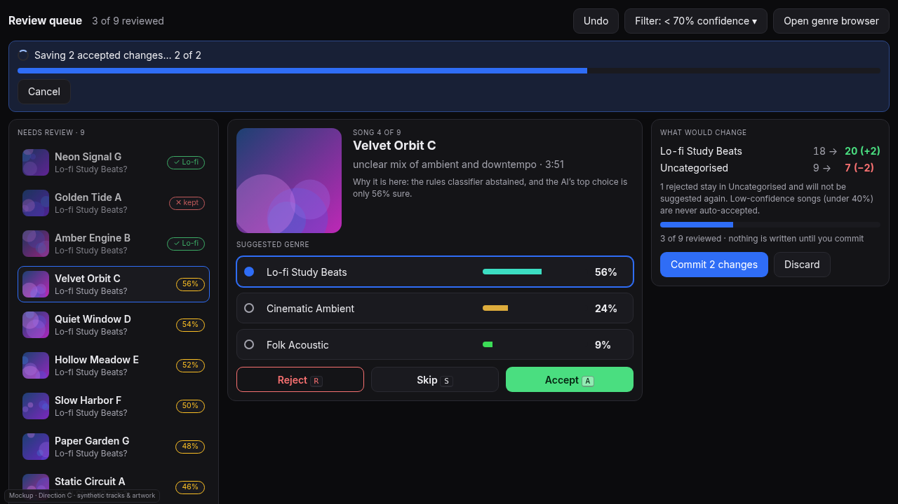
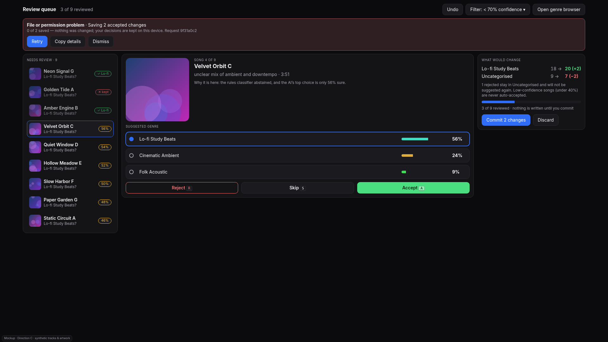
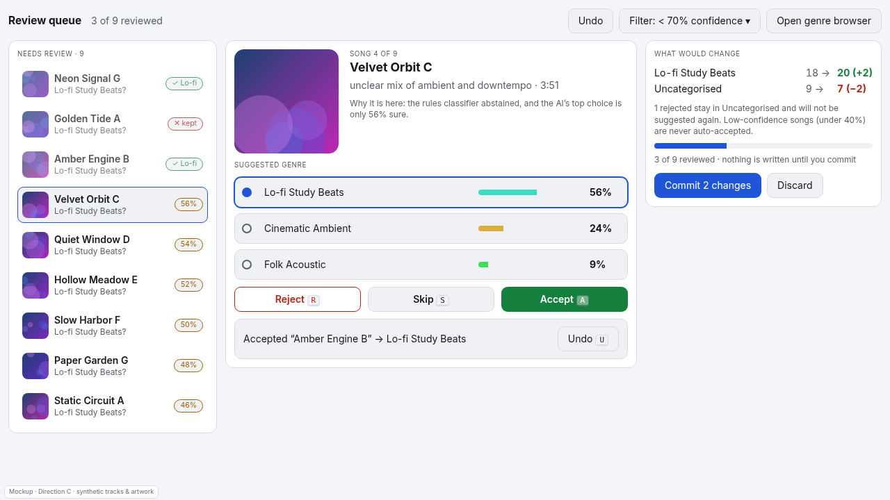

# Direction C (my pick): review queue for low-confidence / Uncategorised songs

Mockup: [`mockups/c-review-queue.html`](mockups/c-review-queue.html) · synthetic data only.

## Why I chose this one
The bug that started #95 was songs the AI skipped being silently put in the wrong place. The fix (leave them where they
are and say "N song(s) were not classified") is correct but leaves a pile nobody works through. A review queue turns
that leftover pile into a task: low-confidence and Uncategorised songs, one at a time, each with the classifier's top
suggestions and confidence, accept / reject / skip, and a live **"what would change"** panel before anything is written.
It is the one direction that makes classification *trustworthy*, not just prettier.

## Audience
Anyone whose library has an Uncategorised bucket or partial AI replies, which after a Split is everyone.

## What it is
- **Queue** (left): songs under a confidence threshold, with their state (✓ accepted, ✕ kept, % pending).
- **Focus card** (centre): cover, stored title and style (verbatim), *why it is here* ("rules classifier abstained; AI top
  choice 56% sure"), the top three suggested genres with confidence bars, and Accept / Reject / Skip.
- **What would change** (right): before → after counts per genre, how many rejected stay, how many reviewed, and
  Commit / Discard. Decisions are held locally; **nothing is written until Commit.**
- **Mobile:** a single card (swipe right = accept, left = reject, with large buttons as the real controls), the impact
  summary collapsed under it.

## Pros
- Directly reduces the Uncategorised pile and shows the effect of each decision before it is saved.
- Undo is cheap and obvious (per decision, plus Discard for the whole batch).
- Confidence is honest: low-confidence songs are never auto-accepted.

## Cons
- A second place to work alongside the browser (entry from the genre pane: "Review N unsorted").
- Needs per-song confidence and ranked suggestions from the classifier; today the card only knows the mix
  (system1 / LLM / abstained / pinned), not per-song scores.

## Effort (estimate, not measured)
Medium: about 1–2 weeks. The UI is small; the work is exposing confidence + top-N suggestions from the classifier,
batching Commit as one atomic write with one undo step, and tests.

## Risks
- **Confidence must be real.** If the numbers are not calibrated, the bars mislead; show "unknown" rather than invent one.
- Swipe is easy to trigger by accident: accept/reject show a short Undo toast and the buttons stay the primary path.
- Large queues need paging and a threshold control (the mock shows `Filter: < 70% confidence`).

## How progress, errors and undo are shown
- **Progress:** "3 of 9 reviewed" bar for the review itself; Commit shows the usual working line + bar + Cancel
  (`Saving 2 accepted changes… 2 of 2`).
- **Errors:** the standard banner (cause class, what was saved, request id, Retry / Copy details / Dismiss). On failure
  nothing is written and the decisions stay on the device, so Retry loses no work.
- **Undo:** a toast after every decision (`Undo U`), the header Undo for the last committed batch, and Discard to drop
  all pending decisions.
- **Split preview:** the "N not classified" songs from a Split land in this queue instead of a footnote.

## What the HA card and the web UI must share
The queue is a view of the same module (opened from the genre pane), reusing the operation states, tokens, Undo
and live regions. The web UI shows it read-only (suggestions visible, Accept/Reject/Commit disabled with the reason),
since it cannot call HA's conversation agent.

## Mobile behaviour
One card per screen, 44px+ controls, buttons as the primary path and swipe as an optional shortcut, impact summary
collapsed, no horizontal scrolling.

## Accessibility
Suggestions are a `radiogroup`; Accept / Reject / Skip / Undo have visible keyboard shortcuts (`A R S U`); the focus
card announces "song 4 of 9" and the top suggestion; progress is a labelled progressbar; confidence is text as well as
a bar (never colour alone); the swipe gesture always has a button equivalent (WCAG 2.5.1 / 2.5.7).
