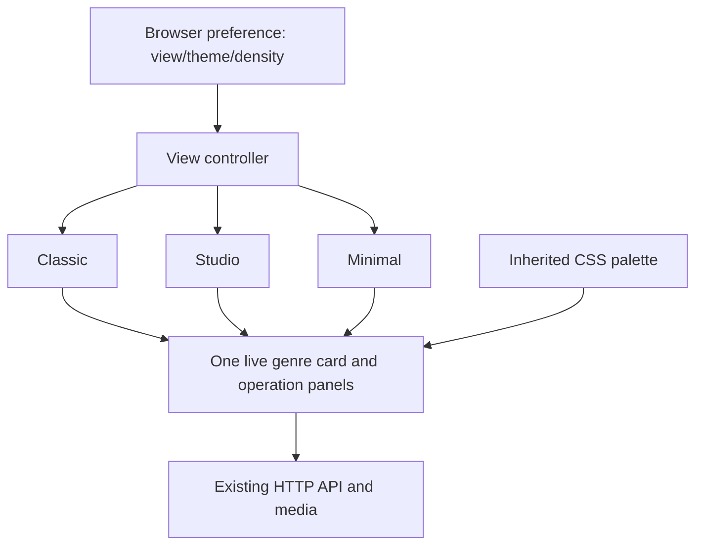
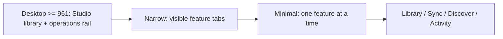

# Suno CLI three-view dashboard MVP

## Isolation

Branch: feat/ui-three-modes-mvp
Base: origin/master 720943c8d16739568babd3e02c16cddf9b67a7cc
Worktree: /mnt/data/active-projects/suno-cli-ui-modes-mvp

Source-only implementation on tracked remote-master frontend. The protected dirty
main checkout and its untracked frontend assets differ substantially from
remote master and must not be overwritten, copied or reconciled without
provenance review and explicit permission.

## Architecture

Browser local preferences select Classic, Studio or Minimal layouts.
The controller updates CSS data attributes, keeping a SINGLE permanent
SunoGenreCard component and the SAME three operation panels mounted.
This preserves component-managed audio, filters, expanded tracks and form
inputs as users change their preferred layout.

The settings are orthogonal:
- View: Classic, Studio or Minimal.
- Appearance: System, Dark, Light or High contrast.
- Density: Comfortable or Compact.
- Active feature: Library, Sync, Discover or Activity.

Preferences only contain these validated strings, stored in namespaced
localStorage when permitted. Storage unavailable or malformed defaults safely.

Studio exposes a wide music library with operations in a sidebar on large
screens, switching to visible navigation on smaller screens.
Minimal exposes one feature area at a time, with every feature reachable
through the explicit navigation. Classic retains the original overall page.
The original /api endpoints and permission boundaries are unchanged.

## Responsive navigation

## Files

- src/suno_dl/webui.py: selector, navigation, layout CSS, panel IDs,
  static-file allowlist. Existing API operations untouched.
- src/suno_dl/webui_static/suno-view-modes.js: preferences and navigation.
- src/suno_dl/webui_static/suno-genre-card.js: theme tokens and density
  adapter, with original defaults for Home Assistant.
- tests/js/view_modes.mjs: synthetic fake-DOM state tests.
- tests/test_view_modes.py: page and packaging invariants.

## Source-only gates

Use a targeted pytest invocation against tests/test_view_modes.py with
PYTHONDONTWRITEBYTECODE=1 and PYTHONPATH=src. Run Node synthetic fake-DOM
checks, Ruff and node --check, all without downloads or a production server.
Python 3.13 grammar checks are useful but NOT full runtime or installed-wheel
support evidence.

## Outstanding tasks for next agent (approval-gated)

1. Independent code review and source-only test extension, especially
   theme persistence and navigation on 320 to 1920px viewport widths.
2. Isolated browser smoke with existing tools only after approval; do not
   start a production dashboard or trigger download/recommendation endpoints.
3. WCAG 2.2 AA audit: keyboard/focus, Shadow DOM menu semantics, mobile sheet,
   live status announcements, touch sizes, color contrast and zoom/reflow.
4. Refine theme bridge; some nested colors still use hard-coded values.
5. Confirm playback and filters remain stable during actual browser view changes.
6. Address real Sync action confirmation, status network failures and log
   updates as separately reviewed UX refinements.
7. Confirm existing HA editing permissions and API contracts are preserved.
8. Reconcile protected dirty-main frontend only with explicit permission.
9. Prepare a draft PR only when separately authorized. Do not enable hosted
   GitHub Actions, merge, deploy, restart, install or launch agents.

Suggested implementation breakdown: shared state/persistence hardening,
responsive layout polish, complete light/contrast theme migration,
accessibility fixes, and approved synthetic browser regression coverage.

## Independent P0/P1 source-only hardening (13 October 2026)

The following focused corrections were made in this isolated worktree, with
no browser launch, local service startup, application operations, downloads,
agent delegation, deployment, CI or GitHub write:

- Restrict the genre-card window keyboard handler to events whose composed
  path contains the component; preserve native keys on buttons, links,
  selects, input fields, contenteditable and other interactive controls.
  Esc on a focused input within the component continues to work.
- Add alert/status/genre foreground and background tokens to the standalone
  appearance palette, including independent light, system-light and
  high-contrast values. Targeted mathematical contrast oracles require at
  least 4.5:1 for normal status and detail text.
- Scope all genre appearance CSS to the explicit standalone
  data-suno-theme opt-in. Home Assistant keeps the original non-MVP CSS
  declarations and default variables; the standalone controller alone
  supplies the opt-in attribute.
- Align Studio sidebar collapse with the genre card's 700px narrow
  container rule using a 1199px viewport breakpoint.
- Track feature focus when resizing from wide Studio to compact tabs;
  keep the focused feature visible even if the browser blurs its input
  before the resize callback. Navigation buttons use aria-pressed only
  when the layout is exclusive; keyboard activation focuses the chosen
  section and pointer activation retains navigation focus.
- Extend source-only Python and Node tests for scope, keyboard interception,
  theme palettes, focus, viewport transitions and fallback styling.

Approval-gated remaining work: synthetic browser responsive snapshots,
actual keyboard/screen-reader/device verification, auditing all hard-coded
colors and touch hit targets, confirming playback continuity with real
audio elements in an isolated no-operation fixture, and additional feature
UX improvements. Do not infer production release readiness from these
source-only regressions.
